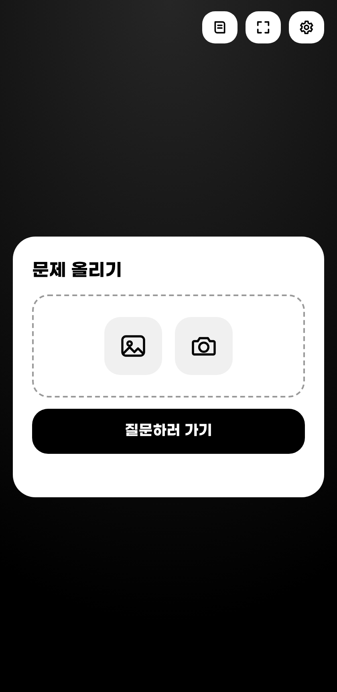
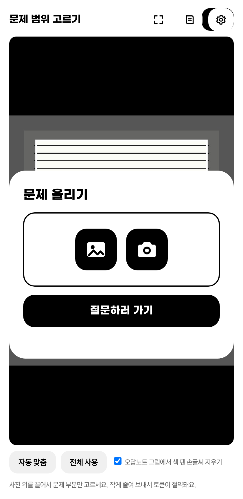
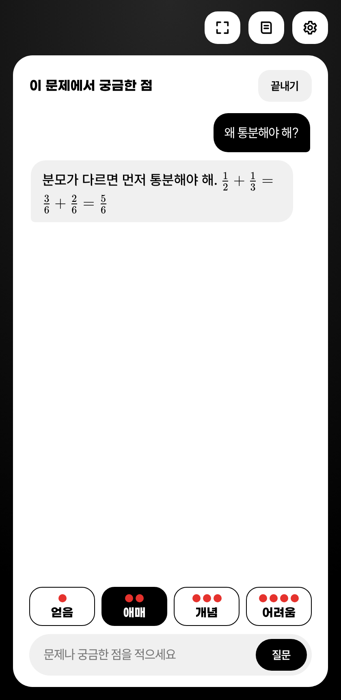
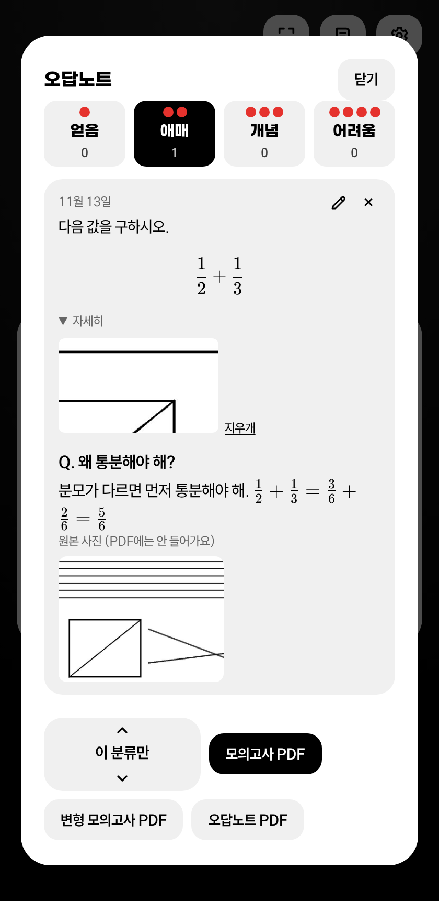
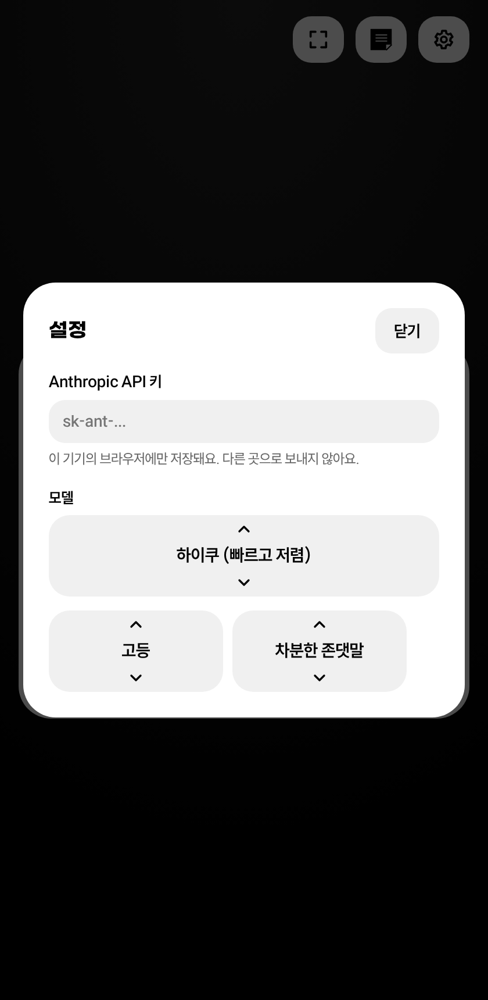

# 과외쌤 (독립형 앱)

문제를 올리고 궁금한 점만 물어보는 공부용 앱입니다. 캐릭터·얼굴 없이 기능만 있습니다. 빌드 없이 정적 파일 그대로 동작하고, 홈 화면에 설치(PWA)할 수 있습니다.

## 화면

| 첫 화면 | 범위 고르기 | 질문 | 오답노트 | 설정 |
|---|---|---|---|---|
|  |  |  |  |  |

PC 화면: [첫 화면](screenshots/pc-1-home.png) · [범위 고르기](screenshots/pc-2-crop.png) · [질문](screenshots/pc-3-ask.png) · [오답노트](screenshots/pc-4-notes.png) · [설정](screenshots/pc-5-settings.png)

(스크린샷은 가짜 응답으로 찍은 예시입니다.)

## 문제 올리는 법
- 앨범 아이콘: 사진 고르기(스크린샷도 앨범에 있으면 여기서) / 카메라 아이콘: 바로 찍기
- 어느 쪽이든 사진이 큰 창에 뜨면 끌어서 문제 범위를 정하고 "완료"를 누릅니다. 붙여넣기(Ctrl+V)와 끌어다 놓기도 됩니다.

## 기능 메모
- **설명 칸 보기**: 풀이를 요청하면 사용된 개념, 조건 해석, 풀이 방향, 풀이, 빠른 풀이(교과 외 공식 포함), 자주 하는 실수, 한 줄 정리가 칸으로 나뉘어 한 칸씩 보입니다. 공식 번호 칩을 누르면 그 공식을 쓴 줄이 강조됩니다.
- **오답노트에 담기**: 칸마다 체크 버튼으로 오답노트에 넣을 칸만 고릅니다. 분류 버튼(얻음 · 애매 · 개념 · 어려움)을 누르면 저장되고, 오답노트에서 연필 아이콘으로 문제·질문·답을 고칠 수 있습니다.
- **PDF**: 모의고사(명조체 2단, 한 단에 두 문제씩, 풀이 칸 없음), 변형 모의고사(저장한 문제를 Claude가 같은 개념의 새 문제로 바꿔 만듦), 오답노트(카드형). 명조체는 나눔명조(SIL OFL, `fonts/NanumMyeongjo-OFL.txt`)를 씁니다.

## 폴더
- `index.html` 화면 뼈대, `css/` 스타일, `js/` ES 모듈
  - `drawer.js` 문제 올리기 화면(사진/글, 영역 선택)
  - `session.js` 질문 세션 / `claude.js` API 호출 / `notes.js` 오답노트 / `pdf.js` PDF / `figures.js` 그림 추출 / `settings.js` 설정 / `db.js` IndexedDB
- `vendor/` KaTeX, jsPDF, html2canvas, `fonts/` 폰트, `icons/` 아이콘
- `sw.js` 오프라인용 서비스 워커. 파일을 추가·수정했으면 `sw.js`의 `VERSION`을 올리고 `SHELL` 목록을 맞추세요.

## 로컬 실행
```
cd app
python3 -m http.server 8000
```
브라우저에서 `http://localhost:8000` 을 엽니다. (서비스 워커·카메라는 `localhost` 또는 https에서만 동작)

## GitHub Pages 배포
`app/` 폴더 내용을 Pages 게시 대상(예: 별도 브랜치 루트나 `/docs`)으로 올리면 바로 동작합니다. 모든 경로가 상대 경로라 하위 주소(`https://이름.github.io/저장소/`)에서도 됩니다.

## 폰 홈 화면에 설치
- 아이폰: Safari로 주소를 열고 공유 → "홈 화면에 추가"
- 안드로이드: Chrome 메뉴 → "앱 설치" 또는 "홈 화면에 추가"

## API 키 넣기
앱의 설정(톱니바퀴)에서 Anthropic API 키를 붙여 넣습니다. 키는 그 기기 브라우저의 localStorage에만 저장되고, `api.anthropic.com`으로만 전송됩니다. 코드나 저장소에는 키를 넣지 마세요. 모델은 설정에서 하이쿠(기본) / 소네트 중 고릅니다.

## 데이터
오답노트는 브라우저 IndexedDB에 저장됩니다(서버 없음). 브라우저 데이터를 지우면 함께 사라집니다.
